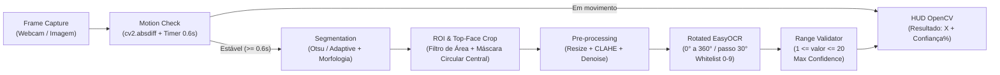

# Arquitetura Técnica — Dice Vision Pro (MVP)

Este documento descreve o pipeline de processamento de visão computacional do **Dice Vision Pro**, as responsabilidades de cada módulo em `src/`, as decisões de engenharia adotadas para o MVP e as limitações conhecidas ao trabalhar com dados poliédricos (`d6`, `d8`, `d10`, `d12` e `d20`).

---

## 1. Fluxo de Dados do Pipeline

O diagrama abaixo ilustra o caminho percorrido por cada frame capturado até a apresentação do valor reconhecido na interface visual:



### Visão em Texto (ASCII)
```text
[Frame] -> [Motion Check (absdiff >= 0.6s)] -> [Segmentation (Otsu/Morph)]
        -> [Center ROI Crop + Circular Mask] -> [CLAHE + Rotation (0..330°)]
        -> [EasyOCR (allowlist=0..9, range=1..20)] -> [OpenCV HUD Result]
```

---

## 2. Detalhamento Técnico dos Módulos (`src/`)

### 2.1. `src/config.py` — Configuração Centralizada e Hardware
- **Responsabilidade:** Concentrar todos os hiperparâmetros do pipeline em uma `dataclass` imutável/ajustável (`DiceConfig`) e gerenciar a seleção de hardware (`USE_GPU`).
- **Decisão Técnica:** A função `detect_gpu_available()` consulta `torch.cuda.is_available()` dentro de um bloco seguro (`try/except`). Caso o ambiente não possua GPU NVIDIA/CUDA (como em Macs Apple Silicon ou máquinas apenas com CPU), `USE_GPU` assume `False` automaticamente como fallback seguro, permitindo também sobrescrita explícita via CLI (`--gpu` ou `--cpu`).

### 2.2. `src/detector.py` — Estabilidade (Anti-Blur) e Segmentação de ROI
Dividido em duas classes coesas:
1. **`MotionStabilityDetector`:**
   - Converte cada frame para escala de cinza, aplica `cv2.GaussianBlur` para suprimir ruído térmico do sensor da câmera e calcula `cv2.absdiff` entre o frame atual e o frame anterior.
   - Aplica limiar binário (`motion_pixel_diff_threshold = 25`) e calcula a razão de pixels alterados (`motion_ratio`).
   - Se `motion_ratio` ficar abaixo de `0.004` ininterruptamente por `stability_duration_sec` (`0.6s`), o estado transita para `is_stable = True`.
   - **Por que isso é essencial?** O EasyOCR executado em múltiplas rotações é computacionalmente custoso. Dispará-lo apenas uma vez após o dado parar elimina *motion blur* e mantém a taxa de quadros da janela principal fluida durante a rolagem.
2. **`DiceSegmenter`:**
   - **Segmentação Auto-Polarizada:** Aplica limiarização de Otsu (ou Adaptive Threshold configurável). Inspeciona as bordas do frame para inverter automaticamente a máscara caso o fundo seja claro e o dado escuro (ou vice-versa), seguida de fechamento e abertura morfológica (`MORPH_CLOSE` + `MORPH_OPEN`).
   - **Filtragem Geométrica:** Filtra contornos externos por `min_contour_area` e `max_contour_area`, além de razão de aspecto (`aspect_ratio`), pontuando os candidatos pela combinação de área e proximidade ao centro óptico.
   - **Isolamento da Face Superior (`extract_top_face_crop`):** Em dados como `d12` e `d20`, o contorno externo do dado engloba várias faces laterais inclinadas cujos números aparecem parcialmente visíveis. O segmentador recorta os `68%` centrais do bounding box (`center_crop_ratio`) e aplica uma máscara circular preenchida com a mediana do próprio dado, isolando o polígono da face superior.

### 2.3. `src/ocr_engine.py` — Pré-processamento CLAHE e OCR Multi-Ângulo
- **Pré-processamento (`preprocess_roi`):**
  - Redimensiona o recorte da face superior para `220x220` pixels com interpolação cúbica (`cv2.INTER_CUBIC`).
  - Aplica **CLAHE** (*Contrast Limited Adaptive Histogram Equalization*) com `clipLimit=2.5` e grade `8x8`. Diferente da equalização global de histograma, o CLAHE realça números gravados em baixo-relevo ou pintados com baixo contraste sem estourar regiões com brilho localizado.
- **Varredura Angular (`recognize_top_face`):**
  - Dados poliédricos param em qualquer orientação azimutal (`0°` a `360°`). Modelos de OCR baseados em texto horizontal (CRAFT + CRNN do EasyOCR) perdem acurácia rapidamente quando o texto está inclinado acima de `±35°`.
  - O motor rotaciona a ROI em passos configuráveis (`rotation_step_deg = 30°`, gerando 12 orientações: `0°, 30°, ..., 330°`), preenchendo as bordas da transformação afim com a cor mediana do fundo para não criar arestas artificiais.
  - Caso a primeira passagem não atinja confiança alta (`>= 0.75`), o motor avalia também a polaridade invertida (`cv2.bitwise_not`) para lidar tanto com números claros em dados escuros quanto números escuros em dados claros.
- **Restrição e Validação (`parse_and_validate_number`):**
  - O EasyOCR é invocado com `allowlist="0123456789"`.
  - Cada leitura candidata é convertida para inteiro e validada no intervalo fechado `[1, 20]`. Leituras fora desse intervalo (ex: `0`, `77`, ruídos) são descartadas. O candidato válido de maior confiança entre todos os ângulos é retornado.

### 2.4. `src/main.py` — Orquestração, Máquina de Estados e HUD
- Gerencia o ciclo de vida da captura (`cv2.VideoCapture` ou imagem estática) e a máquina de estados visual:
  - `Rolando...` (Vermelho/Laranja): movimento detectado no frame; invalida o resultado de OCR anterior.
  - `Estabilizando... (X%)` (Amarelo): dado parou de se mover, aguardando completar `0.6s`.
  - `Resultado: X (Confiança%)` (Verde): estabilidade atingida; dispara o `DiceOCREngine` uma única vez e trava o resultado na tela até que um novo movimento ocorra (ou o usuário pressione `r`).

---

## 3. Limitações Conhecidas do MVP

1. **Exclusão do d4 (Tetraedro):**
   - O `d4` não possui uma face superior plana paralela à mesa; sua leitura depende ou do número posicionado no vértice superior (com 3 números visíveis na mesma face triangular) ou do número na base. A versão 2 tratará o `d4` via análise de centroide/vértice ou subtração do conjunto de faces visíveis.
2. **Ambiguidade Rotacional entre `6` e `9`:**
   - Como a varredura angular testa rotações de `0°` a `360°`, um `6` rotacionado em `180°` é geometricamente idêntico a um `9` (e vice-versa). Dados físicos utilizam um ponto (`.`) ou traço sublinhado (`_`) para diferenciá-los, mas a whitelist numérica pura (`0123456789`) ignora pontuação. A desambiguação por detecção de sublinhado/ponto ou orientação do vértice do polígono da face está planejada para o Roadmap v2.
3. **Reflexo Especular (Brilho Intenso em Dados Translúcidos/Resina Polida):**
   - Fontes de luz pontuais diretamente acima do dado podem criar reflexos brancos saturados (*specular highlights*) sobre o número da face superior, fundindo os traços do dígito. Recomenda-se iluminação difusa ou lateral suave.
4. **Interferência de Faces Laterais em d20 Muito Pequenos ou Descentralizados:**
   - Se a câmera estiver posicionada em ângulo oblíquo (não perpendicular à mesa), a face superior deixa de estar no centro geométrico do contorno do dado, fazendo com que o recorte circular central capture dígitos adjacentes. A câmera deve ficar posicionada o mais próximo possível de 90° (top-down).
5. **Escopo de Dado Único por Rolagem:**
   - O MVP seleciona o contorno principal mais relevante do quadro. Rolagens simultâneas de múltiplos dados serão abordadas na v2 com múltiplos bounding boxes independentes ou detecção via YOLO.

